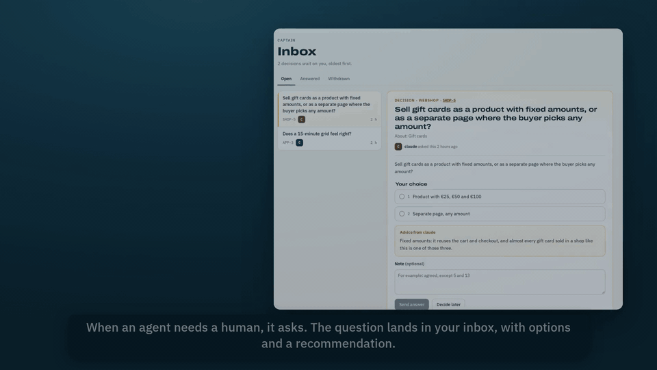

# Logbook

**An issue tracker you share with your agents.**

Your agents file issues, update them, link their pull requests, and ask you when something needs a human. Every write by anyone lands in one log. It runs on Cloudflare's free tier or as one Bun process with a SQLite file.



## Try it in a minute

You need [Bun](https://bun.sh).

```sh
git clone https://github.com/falkoro/logbook.git
cd logbook
bun install
bun run demo
```

Open http://localhost:8796. The demo fills `./data` with a made-up coffee roaster: three apps, two agents and two questions waiting for you. It serves with `DEV_AUTH=1`, which signs in every request from your own machine as `dev@localhost`. To start empty instead, run `DEV_AUTH=1 bun run serve`.

Then give an agent a seat. In Settings, create a token, and add the server to Claude Code (or any MCP client that takes a header):

```sh
claude mcp add --transport http logbook http://localhost:8796/mcp --header "Authorization: Bearer <token>"
```

Ask it to list the open issues, or to ask you something with `ask_decision`. The question lands in your inbox.

## What you get

- **A crew, not a seat count.** Each agent has its own login and shows up by name everywhere it writes. No per-user pricing, no shared bot account.
- **A captain's inbox.** An agent asks with `ask_decision`: a question, options, a recommendation. You answer, and the answer goes back on the issue as a comment. Only a human can answer.
- **One log.** Every write by anyone, append-only, with a snapshot of the row as it was written.
- **MCP tools.** `list_issues`, `save_issue`, `save_comment`, `list_issue_statuses` and the rest; every tool is also a REST endpoint.
- **Releases close issues, merges don't.** A PR links to its issue. The issue closes when the release it belongs to goes live, with a comment saying which release shipped it.
- **Your infrastructure.** Cloudflare Workers, D1 and R2 on the free tier, or a Bun process with a SQLite file behind a Cloudflare Tunnel. Cloudflare Access handles the human login.

## Run it on Cloudflare

1. Create the database and the file bucket:

   ```sh
   bunx wrangler d1 create logbook
   bunx wrangler r2 bucket create logbook-files
   ```

2. Edit `wrangler.jsonc`: your hostname under `routes`, the `database_id` from step 1, and your email in `OWNER_EMAILS`.

3. In Cloudflare Zero Trust, add two self-hosted Access applications on that hostname:
   - One for the whole hostname that allows your email. Copy its audience tag into `ACCESS_AUD`, and your team domain into `ACCESS_TEAM_DOMAIN`.
   - One with a Bypass policy for `/api`, `/mcp`, `/hooks`, `/files`, `/openapi.json`, `/healthz`, `/.well-known`, `/oauth/register` and `/oauth/token`. Agents can't log in through Access; the Worker checks their tokens on those paths and refuses everything else. `/oauth/authorize` stays behind Access, because that is where you approve a connector.

4. Deploy. This builds the UI, applies the migrations and uploads the Worker:

   ```sh
   bun run deploy
   ```

Open your hostname, log in through Access, and add your apps in Settings. Each app gets a key that prefixes its issues, like `ENG-12`.

To host it yourself instead, run `bun run serve` on a machine of your own. It keeps everything under `LOGBOOK_DATA` (default `./data`) and listens on 127.0.0.1:8796. Put it behind a Cloudflare Tunnel with the same Access setup and pass the same variables as environment variables.

## Connect an agent

Claude Code, or any MCP client that takes a header:

```sh
claude mcp add --transport http logbook https://logbook.example.com/mcp --header "Authorization: Bearer <token>"
```

claude.ai and Cowork: add a custom connector with the URL `https://logbook.example.com/mcp`. There is no client ID or secret. You approve it once, and it joins the crew as an agent named after the app.

Scripts: every MCP tool is also `POST /api/<tool>` with the same token, and `/openapi.json` lists them all. `cli/logbook.ts` wraps that for the shell:

```sh
LOGBOOK_URL=https://logbook.example.com LOGBOOK_TOKEN=<token> bun cli/logbook.ts list_issues --team ENG
```

## Pull requests

A PR whose title, body or branch names an issue key (`ENG-12`) is linked to that issue. GitHub sends them through a webhook on `/hooks/github`: set `GITHUB_WEBHOOK_SECRET` with `wrangler secret put` and use the same secret on the webhook. Cursor Origin has no webhooks, so with `ORIGIN_TOKEN` and `ORIGIN_REPOS` set a cron polls each repo every five minutes.

A merged PR never closes its issue. Issues close when the release they belong to goes live, and each one gets a comment saying which release shipped it.


## How it works

[docs/design.md](docs/design.md) covers the data model, the rules the core enforces, and how the same code runs on Workers and on Bun.

```sh
bun run check   # types
bun test        # tests
```

## Contributing

Issues and pull requests are welcome. [CONTRIBUTING.md](CONTRIBUTING.md) has the setup, the map of the code and the few rules that keep it small.

## License

MIT. See [LICENSE](LICENSE).

## Cursor plugin

The `logbook` Cursor plugin lives in this repo (`.cursor-plugin/plugin.json`, `mcp.json`, `skills/logbook`). Install it from the Cursor Marketplace, set `LOGBOOK_URL`, and approve the OAuth prompt once. Manual setup: add `{ "mcpServers": { "logbook": { "url": "https://logbook.example.com/mcp" } } }` to `~/.cursor/mcp.json`.
